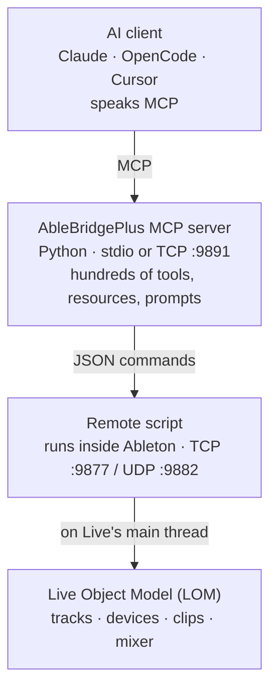
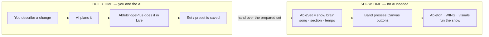
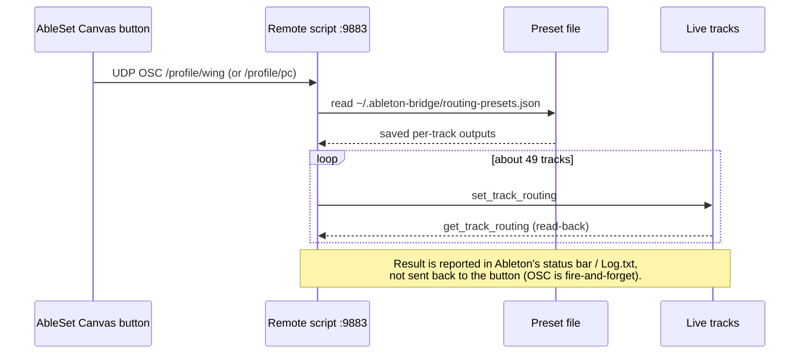
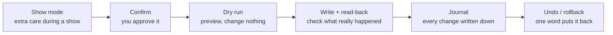
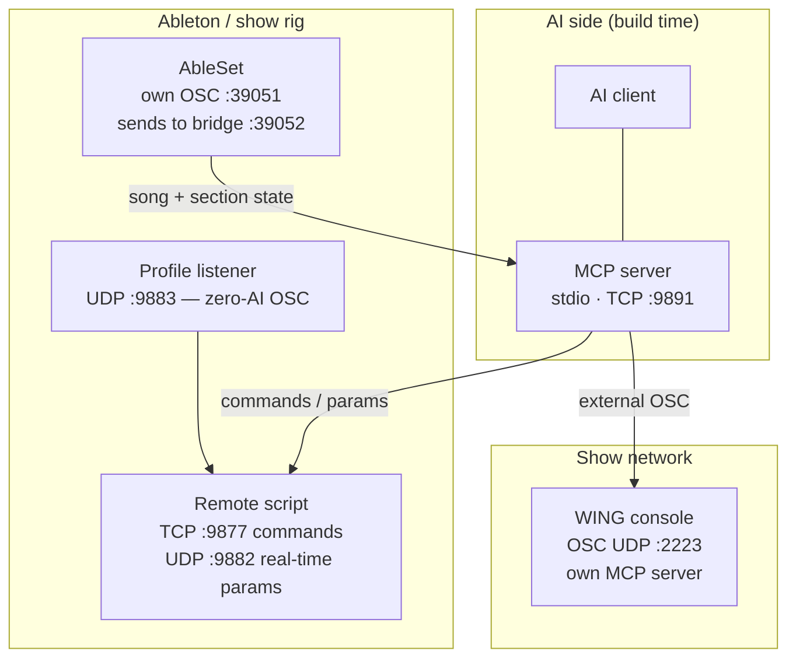

# AbleBridgePlus, in pictures

A few short diagrams to go with the words in the
[README](../README.md). Each one has a plain-language caption, so you can
read the caption and skip the boxes if that's easier. Nothing here is a hard
rule — it's a map of how the pieces normally fit together.

> These are schematic illustrations, not photos and not exact wiring diagrams.

---

## 1. The layers

The path from you to your music is four boxes long: an AI client calls the
bridge, the bridge calls a small script living inside Live, and that script
moves the real tracks, devices and clips.

---

## 2. Build time vs. show time

The AI is a **build-time** helper: you use it to set up, edit and rehearse the
set, then it steps aside — once the show starts, AbleSet is the brain and the
bridge's tools just sit there ready if you need them.

---

## 3. One-click audio profiles (no AI in the loop)

A single AbleSet Canvas click sends one OSC message straight to a listener
inside Live, which reads a saved preset and re-routes every track — no AI, no
Python and no MCP server anywhere in that path.

---

## 4. The safety idea

The guardrails are: ask before acting, preview a risky change, verify what
actually stuck, keep a diary, and leave an undo ready — with an extra
"show mode" gate on gear that can be heard by an audience.

A note on that first pair: **show mode** and **confirm** are the guardrails used
by live-show gear such as the WING mixer's own MCP server. Inside AbleBridgePlus
the safety features you'll actually meet are **dry run** (for example on
`apply_output_preset`), the verified **write + read-back**, the **change
journal**, and **rollback**.

---

## 5. The ports map

Only a handful of ports are involved: `:9891` is AI-to-bridge, `:9877`/`:9882`
and `:9883` reach Live, `:39051`/`:39052` carry AbleSet's song state, and
`:2223` reaches the WING console.

A couple of practical notes, because they trip people up:

- AbleSet forgets its subscription when it restarts. If song state goes
  missing, re-subscribe by hand from AbleSet's OSC settings page
  (`/subscribe 127.0.0.1 39052 AbleBridgePC`). The `subscribe_ableset` tool is
  not reliable for this — the manual step is the dependable one.
- `:39051` is **AbleSet's own** listen port; the bridge listens on `:39052` so
  the two never collide.
- `doctor` is the quickest way to spot version drift between the installed remote
  script and the MCP server.

---

Back to the [README](../README.md), or see
[docs/ARCHITECTURE.md](ARCHITECTURE.md) for the deeper protocol details.
