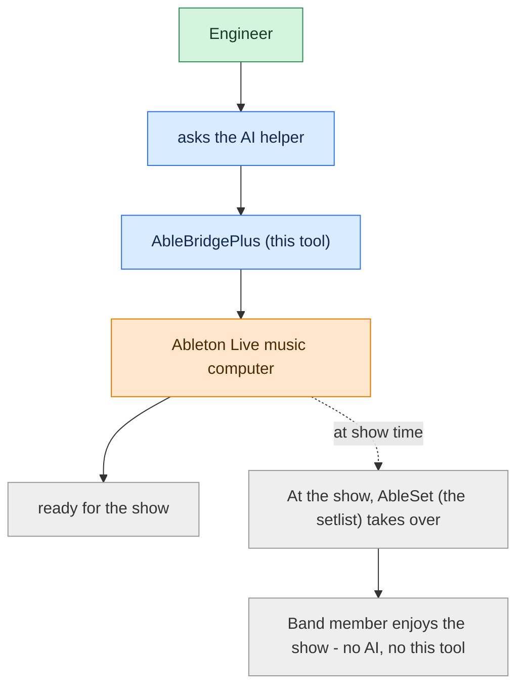

# AbleBridgePlus, the easy picture

This is a helper the engineer uses BEFORE the show to set up the music computer. Nobody uses it during the show.

*Before the show: the engineer asks the AI helper, which uses this tool to get the music computer ready. At the show: the setlist app takes over, and neither the AI nor this tool is used.*

| Who | When | Uses this? |
| --- | --- | --- |
| Engineer | Before the show | Yes — sets it up |
| AI helper | Only before the show | Yes — helps the engineer |
| Band member | During the show | No — never touches it |

> **A note about safety:** This tool can change the music computer's settings. We made it careful — it shows a preview first and can undo.

Want more detail? See the [bigger diagram](BRIDGE-DIAGRAMS.md) and the [picture of how the pieces fit together](images/bridge-layers.svg).
